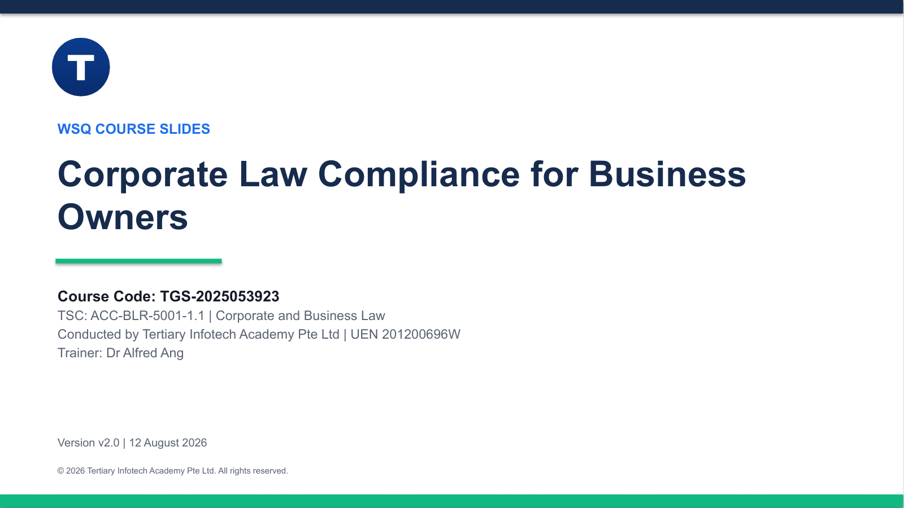

# Corporate Law Compliance for Business Owners

WSQ courseware for **TGS-2025053923**, aligned to **ACC-BLR-5001-1.1 Corporate and Business Law**.

[View the course and registration information](https://www.tertiarycourses.com.sg/wsq-corporate-law-compliance-for-business-owners.html)

## Package

- `courseware/Corporate Law Compliance for Business Owners-v2.0.pptx` — 103-slide trainer deck
- `courseware/Corporate Law Compliance for Business Owners-v2.0.pdf` — learner slide PDF
- `courseware/LG-Corporate Law Compliance for Business Owners-v2.0.docx` and PDF — detailed Learner Guide
- `courseware/LP-Corporate Law Compliance for Business Owners-v2.0.docx` and PDF — mapped Lesson Plan
- `labs/` — eight detailed case-study and activity worksheets
- `SOURCES.md` — primary and comparative source register

The PowerPoint is concept-led and visual. Detailed step-by-step activity procedures are intentionally confined to the Learner Guide and Markdown worksheets.

## Approved competency map

| Code | Approved focus |
|---|---|
| K1 | Latest global developments and the regulatory/legal framework in which the organisation operates |
| K2 | The organisation's business, environment and industry |
| A1 | Assess the organisational impact of global and legal/regulatory changes |
| A2 | Drive decision-making based on changes in laws and regulations |
| A3 | Influence relevant business units to adapt to new regulations |

## Confidential assessments

Assessment papers and answer keys are maintained outside this public repository. They are published only to the controlled courseware Drive/TMS workflow.

## Important

This material is educational and is not legal or tax advice. Requirements can change; verify current regulator guidance and seek qualified advice for material or uncertain matters.
